# 数据转换 (Data Format Converter)

A [DBX](https://dbxio.com) plugin that moves data between formats without leaving the workbench: JSON / YAML / XML / Properties conversion, a field-level diff, a batch-value SQL builder, Excel / CSV → JSON, Image ⇄ Base64, JSON / `CREATE TABLE` straight into model code, JSONPath / jq queries with JSON Schema validation, an escape toolbox, byte conversion (1000 and 1024 scales), timestamps and dates in every notation (local / UTC / ISO 8601 / relative, batched), JSON straight into an ECharts chart exported as PNG / SVG, QR codes both ways — batch generation, or decoding pictures back into text — and pasting a table in to query it with SQL (its own offline engine, completion included). Select anything in any editor and right-click to encode, clean up, build SQL or turn it into a QR image — results land on the clipboard. Fourteen pages, one `Ctrl/⌘ + K` search box that finds them by Chinese, English, synonym, pinyin or initials. Built from the **frontend-only (universal)** template — one cross-platform `.dbxp`, no native backend, no network calls, works offline.

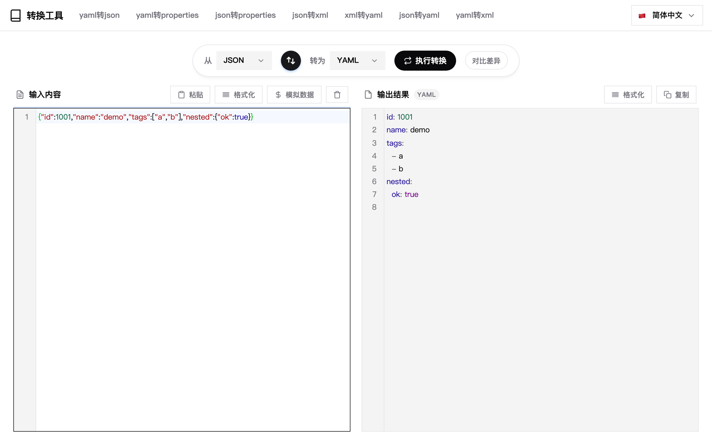

[中文文档](README.zh-CN.md)

## Pages at a glance

| Page | What it does |
| --- | --- |
| **Convert** | Any of 13 formats into any other (JSON / YAML / XML / Properties / TOML / INI / `.env` / CSV / TSV / Query / Headers / Cookie / HTML), instant conversion, validation + formatting, mock data; import a file (dropped or via the button) and the source format is picked for you |
| **Compare** | Field-level JSON diff by JSON Pointer, or a line-level text diff for anything else; each side has its own import button |
| **SQL** | Paste values → `IN` / `NOT IN` / value list / `INSERT`; pasted SQL fragments parse back into clean values |
| **Sheet to JSON** | `.xlsx` / `.csv` / `.tsv` → JSON array or SQL `INSERT`, parsed entirely in the browser |
| **Data stats** | Pasted delimited text → count / sum / mean / max / min / distinct / standard deviation, optionally grouped by another column; the table header doubles as the column picker, numeric columns are picked for you, every preview row carries its source line number with two-way caret syncing; click a cell to copy it, hide the columns you don't need, and big tables lazy-load in batches |
| **SQL analysis** | Paste a table and query it with SQL (`SELECT` / `WHERE` / `GROUP BY` / `HAVING` / `ORDER BY` / `LIMIT` plus the usual functions) through a plain-JS engine that runs offline; Chinese column names complete as you type, clicking a preview header inserts the column, right-clicking a selection runs it, the triangle in the gutter re-runs just that statement, several statements run one by one with a tab each (one failure never stops the rest), `--` and `//` comments are both understood, the statement you wrote is still there next time, and it never executes on its own; imports `.sql` as well as `.csv` / `.tsv` / `.txt` / `.json` / `.xlsx` |
| **Image ⇄ Base64** | Image → DataURI / raw Base64 / CSS / HTML / Markdown, and Base64 (prefixed or bare) back into a picture; both sides import files, and exports import back |
| **Code Gen** | A JSON sample or a `CREATE TABLE` → TypeScript / Go / Java / Python models, nested structures split into their own types |
| **Query & Validate** | JSONPath / jq expressions over a JSON document, JSON Schema (draft-07) validation with path + reason per error, one-click schema inference from data |
| **Escape** | URL / Base64 / HTML / JSON string / `\uXXXX` / hex / SQL literal / regex — encode and decode, with a one-click direction flip |
| **Byte converter** | B / KB / MB / GB / TB / PB on both the 1000 and 1024 scales, exact value ⇄ human readable, batch totals, hex dump / byte array / binary string forms, and every value copies on its own without thousands separators |
| **Time converter** | Timestamps (seconds / milliseconds / microseconds) ⇄ dates, picking from local time, `T`-separated, UTC, ISO 8601 and relative time; one value per line for batches, Now / Today / Yesterday / Week / Month buttons append a line in one click, results fold away, the card for the line your cursor is on gets highlighted, and copying gives you results only |
| **JSON to Chart** | An ECharts option (or an array of numbers / objects) drawn as a chart; API responses, task lists and several JSONs at once are unwrapped and listed for picking; custom width & height, PNG export at 1x / 2x / 3x and vector SVG, plus a full-screen lightbox; the chart engine ships inside the package, no network |
| **QR code** | Any text → one code per line, or one code for the whole block with its line breaks kept; size, error correction, margin and colours are all settings, an icon can sit in the middle; cards fold and jump back to the line they came from, copy the image, or export everything as one PNG; drop pictures and they are decoded back into text |

## Convert

- **Source × target selectors** — 13 formats in any combination, grouped in the dropdown (structured: JSON / YAML / XML / Properties / TOML / INI / `.env`; table & text: CSV / TSV / Query / Headers / Cookie / HTML), with internal scrolling so a long list never spills off screen.
- **TOML** — `[db]` tables, `[[items]]` arrays of tables, inline tables, dotted keys, triple-quoted strings, hex / octal / binary / underscored numbers, `inf` / `nan` and datetimes (carried as strings) are all understood; defining the same table twice reports the line it happened on.
- **INI / `.env`** — flat `[section]` blocks (a later section never nests into the previous one), `export` prefix, quoted escapes and trailing `#` comments; nested `.env` keys flatten to `db.host`.
- **CSV / TSV** — a JSON array becomes a table, with nested objects flattened to `address.city` and arrays to `tags[0]` / `tags[1]`; reading it back restores the nesting plus numbers and booleans. Empty cells are skipped, since CSV cannot tell `null` from an empty string.
- **Query / Headers / Cookie** — paste a captured request and get structure: repeated query keys become arrays (`a=1&a=2` → `["1","2"]`), header parsing skips the request/status line, and bare cookie flags such as `HttpOnly` become `true`.
- **HTML** — an array of objects ⇄ `<table>` with `<thead>` / `<tbody>` and HTML escaping; column names are generated when there is no `<th>`.
- Auto-formatting for JSON / YAML / XML, validation errors that point at the problem, and a mock-data generator for quick schema tests.
- Both panes keep line numbers and syntax colours — TOML, `.env` (shell), Headers (HTTP) and INI (properties) each get their own.
- Everything runs locally: paste → convert happens inside the panel, nothing is uploaded.

## Compare

- **Field-level JSON diff** — both sides are parsed into trees and compared node by node (JSON Pointer), so only the values that actually changed are highlighted, plus a change list (modified / added / removed + path + new value); clicking a row scrolls both panes to it. Cross-format (json ↔ yaml) gives the list without meaningless block colouring.
- **Free-text compare** — Markdown, config files, HTML snippets, logs: compared row by row, removed lines get a red band and edge bar, added lines a green one, no strikethrough so code stays readable. If both sides are valid JSON it suggests the JSON mode instead.
- Four built-in samples per mode, so the page is usable without preparing data.
- **Each side imports its own file** — Import left and Import right load into that pane only, leaving the other one alone; a file dragged onto the window fills whichever side is still empty.

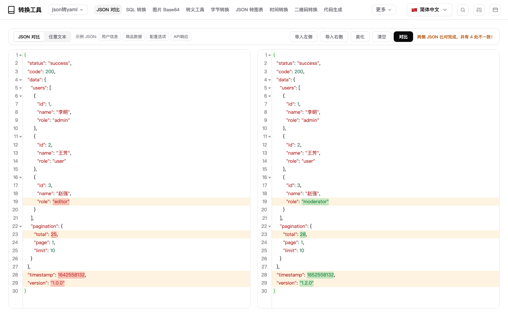

## SQL builder

- Paste one value per line (commas, semicolons and tabs work too) and get SQL on the right: `IN (...)`, `NOT IN (...)`, a plain value list, or `INSERT INTO ... VALUES ...;` — single-line or one per line.
- **Chinese lists paste straight in**: `、` (ideographic comma), `，` (full-width comma), `；` (full-width semicolon) and `|` all count as separators. A column of ids copied out of Excel or a chat window (`100000000000000001、100000000000000002、…`) becomes one value per line instead of one giant string — the kind of failure that "generates fine" and then matches nothing in the database.
- **Whitespace is cleaned up after splitting**: each value is trimmed and its zero-width characters (`\u200B`, BOM), non-breaking spaces (what Excel gives you), full-width spaces and repeated blanks are normalised, so duplicates actually collapse (`'a'` and `'a\u200B'` are no longer two values). Ordinary spaces inside a value are kept — `New York` does not become `NewYork`.
- Quoting is a choice: single quotes, double quotes or none. Numbers are quoted by default (`'31010100003922409'`, because id columns are usually varchar), with a toggle for bare numbers so `int` indexes keep working. Long 18–19 digit ids are handled as text end to end — not a single character is lost.
- A whole `WHERE id IN ('a','b')` or `INSERT ... VALUES ('a'),('b')` fragment parses back into clean values; paired quotes are unescaped, `O'Brien` is not split, duplicates are dropped and both counts are shown.
- Generates as you type, `Cmd/Ctrl+Enter` to force it, one-click copy.

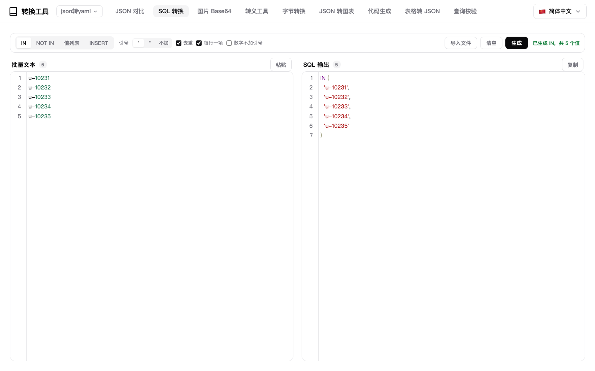

## Sheet to JSON

- Drop an `.xlsx`, `.csv` or `.tsv`: the first row becomes the keys (switchable), the delimiter is sniffed (or pinned to `,` / Tab / `;`), numbers and booleans are inferred while `007` and 15+ digit ids stay strings, short rows are padded and duplicate headers get a `_2` suffix.
- Excel dates come back as `2024-03-01` (built-in and custom `numFmt`), and shared strings / inline strings / booleans / error cells are handled. ZIP64 xlsx files read correctly.
- A live preview table sits beside the output; wide tables scroll horizontally with a persistent scrollbar, and double-clicking a cell opens a detail card with the full value plus the whole row.
- Output is **JSON** (fully indented or one record per line) or **SQL Insert** (table name editable, 500 rows per statement, `'`-escaped, `.sql` export). A **Max records** selector converts only the first N rows.
- Large files stay responsive: 20 MB / 100k rows caps, 500-row preview, chunked serialisation with a progress bar, and a cancel token so a slow file never overwrites a newer one. Exports go through the host `fileTransfer` channel, falling back to `<a download>`.

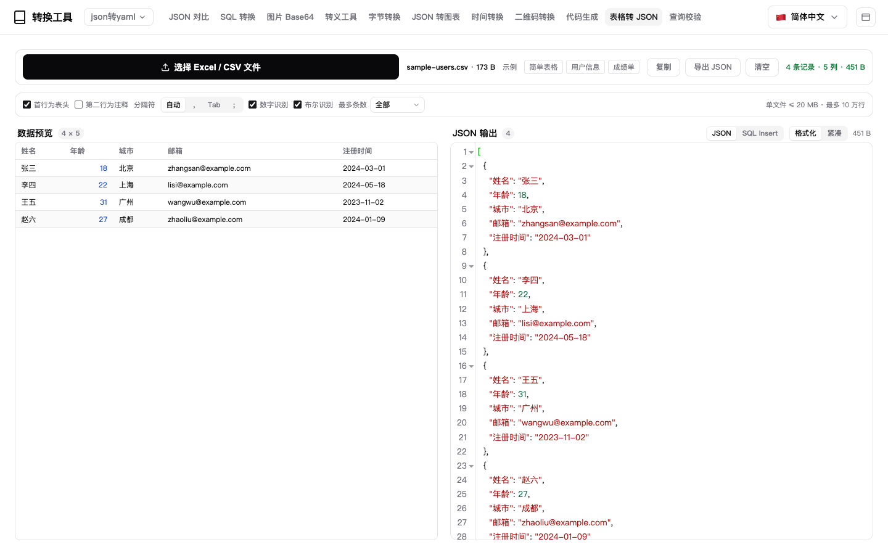

## Image ⇄ Base64

- **Encode**: pick a file, drop it, or press `Ctrl/Cmd+V` to paste a screenshot — output as DataURI, raw Base64, CSS, HTML or Markdown. Switching format never re-encodes.
- **Decode**: paste and the picture appears (300 ms debounced), with size, dimensions, character count and the +33% overhead underneath, on a checkerboard backdrop so transparent PNGs stay visible.
- **Import a file — every export comes back**: the decode side has an **Import file** button that reads `.txt` / `.b64` / `.json` (dropping the file on the pane works too), and everything the encode side exports — `.txt`, `.base64.txt`, even the CSS / HTML / Markdown wrappers — returns as a picture. Import only accepts this page's own kind: picking an image there just tells you to use Image → Base64, the page is never switched under you. Text files are capped at 16 MB and binaries are refused at the door.
- **Raw Base64 equals DataURI**: a bare string with no `data:` prefix works, because the type is sniffed from magic bytes (PNG / JPEG / GIF / BMP / WEBP / ICO / AVIF / HEIC / SVG) and the tip says which one it read. Real-world variants normalise first: 76-column wrapping, url-safe `-_`, missing padding, quotes / `url("…")` / a whole CSS declaration, a partial `image/png;base64,` prefix, a UTF-8 BOM. Pasting Base64 with `Ctrl/Cmd+V` on the encode side switches to decode automatically. There is deliberately **no "read clipboard" button**: macOS WebViews pop their own *Paste* bubble next to the button, so images come in via `Ctrl/Cmd+V` or drag-and-drop — both hand over the full file data.
- **SVG counts as an image**: `.svg` files encode to `image/svg+xml`, SVG Base64 / DataURI decodes back — and since vector art *is* text, pasted **SVG source** is UTF-8 encoded and rendered too. Sniffing skips a BOM, `<?xml?>`, `<!DOCTYPE svg>` and comments, and does not mistake HTML that merely embeds an `<svg>` for an image.
- **Bounded memory, no frozen host**: 10 MB per image, 14 M characters of Base64, rejected up front. Encoding runs in 3-byte-aligned chunks with a progress bar and a cancel token (8 MB ≈ 250 ms). The preview is capped at 200 K characters and above 2 M characters of Base64 the full string is **not** held in memory — the preview is built from a slice and the text is assembled once, on export. Previews use an object URL instead of a multi-megabyte data URI, and **Copy** on a truncated preview points at Export instead of pretending to succeed.

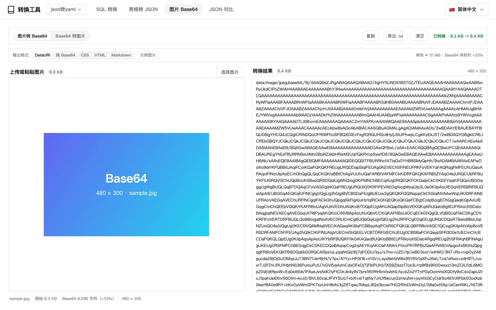

## Code generation

- Paste a **JSON sample** on the left and the model appears on the right: nested objects and arrays of objects become their own types (dependencies are emitted first), duplicate shapes merge, and fields missing from some samples turn optional.
- Or switch to **SQL DDL**: paste a `CREATE TABLE` (MySQL backticks, PostgreSQL double quotes / `serial` all understood) and get the matching model. Column names become lower camel case, table and column comments are carried into the code, table prefixes like `t_` / `tb_` are dropped from type names, and primary keys or index clauses never become fields. Several `CREATE TABLE` statements produce several types at once.
- Switch language at any time: **TypeScript** interfaces, **Go** structs (with `json` tags and `omitempty`), **Java** POJOs (boxed types + getter/setter), **Python** dataclasses (snake_case + `Optional`). No need to re-paste anything.
- The root type name is editable; leave it empty and it is inferred. Messy input (spaces, leading digits, CJK) is sanitised into a legal identifier instead of emitting code that will not compile.
- Inference is pure frontend — no network, no `eval`. Inputs beyond 1M characters, very large arrays and deeply nested values degrade or stop at the door, so the host never locks up.
- Both panes are real editors (CodeMirror): line numbers, syntax highlighting, bracket matching, code folding and active-line highlight. The input is coloured by source format (JSON / SQL DDL) and the output by target language (TypeScript / Go / Java / Python), switching with the tabs; `⌘ / Ctrl + Enter` re-runs in place.

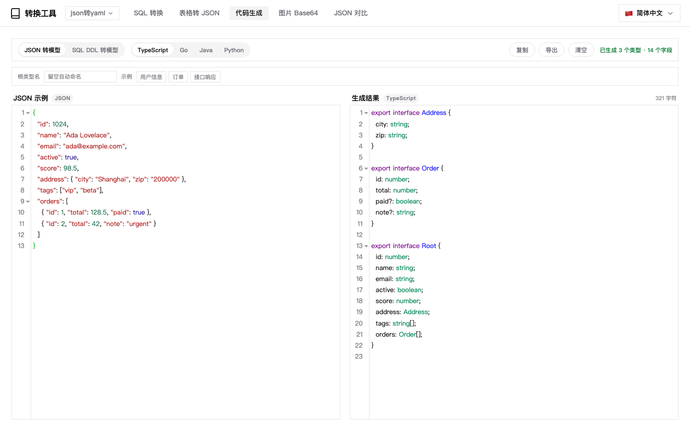

## Query & Validate

- **Two dialects, one parser** — paste a document, type a path. JSONPath (`$`, `.key`, `['key']`, `[0]`, `[*]`, `..` recursive descent, `[start:end:step]` slices, `[?(@.price < 10 && @.cat == "fiction")]` filters with `=~` regex) and a jq subset (`|` pipes, `,` unions, `[]` iteration) both work; which one you meant is detected from the syntax, so there is nothing to configure.
- **Results you can act on** — a single match prints the value itself, several print as a JSON array with the match count on the badge. Under the result sits a **path list** (up to 200 rows, `$`-rooted), and clicking a row copies that path — handy for turning a query into a JSON Pointer or a code constant.
- **JSON Schema validation** — draft-07 subset: `type` / `enum` / `const` / `format`, string (`minLength`, `pattern`…), number, object (`properties`, `required`, `additionalProperties`, `patternProperties`), array (`items`, `contains`, `uniqueItems`, `minItems`…), `allOf` / `anyOf` / `oneOf` / `not`, `if` / `then` / `else`, and local `$ref` (`#/definitions/…`, with a visited stack so a self-referencing schema cannot explode).
- **Errors are readable, not a wall of text** — every error carries the instance path, a localized sentence and a stable code chip (`schema-type`, `schema-required`…), capped at 200 so a hopeless schema still answers instantly.
- **Schema inference** — one click turns the data you already have into a starting-point schema: types inferred, `required` filled in, `format` guessed for emails / dates / UUIDs, array items merged across elements.
- Bounded like everything else: 2 M characters of input, 1 000 result nodes, 200 000 visited nodes — past that the answer is marked truncated instead of the host stalling.

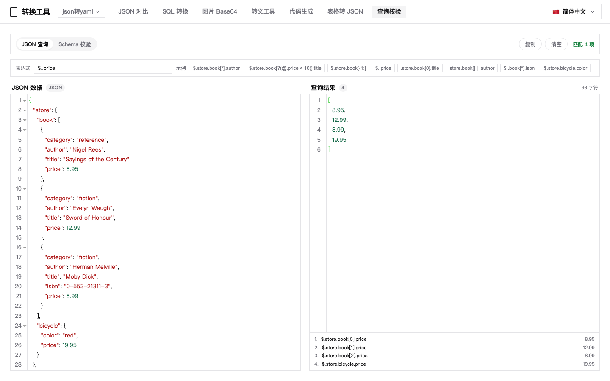

## Escape toolbox

- Eight kinds in one page — **URL**, **Base64**, **HTML**, **JSON string**, **`\uXXXX`**, **hex**, **SQL literal**, **regex** — with an encode / decode switch and a **flip** button that swaps the two panes and the direction in one click, so a round-trip check takes two clicks.
- **Its own page, like the others** — it opens from the nav and stays there until you switch pages, so a long escape session never fights with the rest of the workbench. The nav item highlights like any other page, and the convert / compare / SQL pages are untouched while it is open.
- **JSON string** is a first-class kind, not a side effect of the converter: encoding wraps the text in a JSON literal and escapes `"`, `\` and control characters (`\n`, `\t`, `\u0007`…), leaving CJK and other non-ASCII readable instead of turning everything into `\uXXXX` — that is what the **Unicode** kind is for. Decoding accepts both a full literal (with the outer quotes) and a bare escaped fragment, which is what you usually have after copying from a log line.
- **Encoding is byte-correct, not Latin-1** — Base64 and hex go through a hand-written UTF-8 encoder / decoder rather than `btoa`, so `中文` comes back as `5Lit5paH` instead of mojibake, and decoding restores the text exactly, surrogate pairs included.
- **HTML / SQL / regex** escape only what has to be escaped and never double-escape (`O'Brien` → `O''Brien`, `[a-z]{2}` → `\[a-z\]\{2\}`), while the decoders leave other kinds of escapes intact.
- Invalid input fails with a code (a bad Base64 length, a `\u` without four hex digits…) instead of silently producing garbage, and inputs beyond 2 M characters are rejected up front.

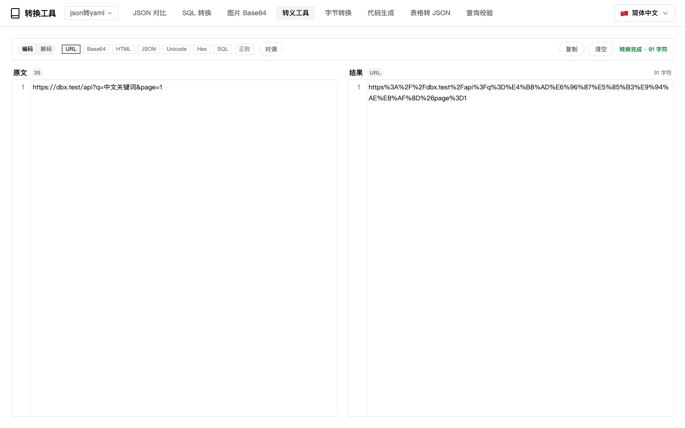

## Byte converter

- **Unit conversion with both bases side by side** — B / KB / MB / GB / TB / PB on the 1000 scale and B / KiB / MiB / GiB / TiB / PiB on the 1024 scale, shown on the same row so 1.5 MB and 1.5 MiB never get mixed up. Decimals adjustable from 0 to 6.
- **Both directions** — type `1234567890` and get `1.23 GB` and `1.15 GiB`; paste `1.15 GiB` and get `1234567890` bytes back. Bare numbers, values with units and shorthands like `700M` all parse, case-insensitively.
- **Batch** — one value per line: mix `1234567890`, `1.5 GB` and `734003200`, and every row gets both conversions with a total at the bottom, which is how you add up a pile of file sizes. A line that cannot be parsed is flagged on its own row and leaves the others alone. Copy produces TSV, so it pastes into Excel as four clean columns.
- **The other ways to write bytes** — paste a byte sequence (`1f 8b 08`, `1f8b08`, `[0x1f, 0x8b]`, `0x1f 0x8b`, binary `00011111 10001011`, or a whole `xxd` dump) and get **hex dump** (xxd style, offsets and ASCII column included), **byte array** and **binary string**, each with its own copy button. This is a different job from the hex kind in the escape toolbox: that one encodes strings, this one is about numbers and byte representations.
- **Every value copies on its own** — each of the three summary cards (exact / base 1000 / base 1024) has its own copy button, and every number in the table is one click away from the clipboard. What lands there is just the number, or the number plus its unit — **never with thousands separators**, so it drops straight into code, a shell command or a config file. The one overall copy button still gives you the TSV.
- Input that makes no sense is rejected rather than guessed at (`zzz` is not read as hex), a single sequence is capped at 8 KB and a value at roughly 1 EiB, and hitting a limit says so instead of freezing the page.

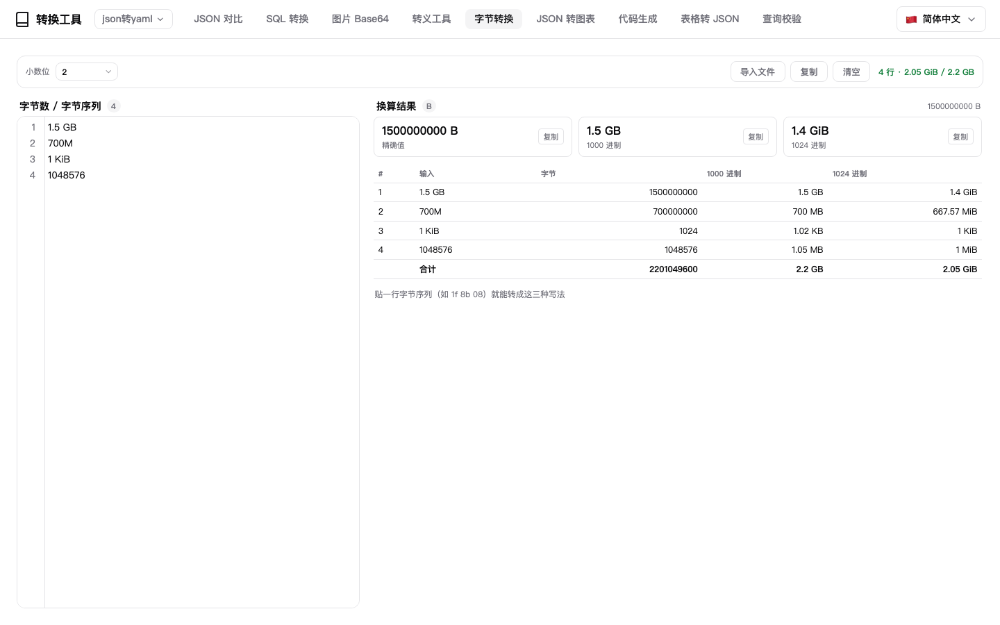

## Time converter

- **Quick actions fill the input for you** — a row of buttons on top: Now, Today start, Yesterday, Week start and Month start. Each click **appends a new line** with that moment to the end of the input and converts right away (Yesterday means yesterday 00:00:00; the week starts on Monday). Values are truncated to the second and written as `2026-10-25 00:00:00`, a notation this page parses, so there is no format to remember.
- **One time per line, mixed notations welcome** — paste `2020-01-01`, `2020-01-01 00:00:00`, `2020-01-01T00:00:00`, `1577836800` and `1577836800000` on their own lines and each line gets every notation it can be expressed in. A line that does not parse is flagged on its own card and the rest still convert, so one bad row never fails the batch.
- **Only the formats you ask for** — seven toggles: Unix timestamp (seconds), Unix timestamp (milliseconds), local time, local time with `T`, UTC, ISO 8601 and relative time. By default only *local time* and *local time (T)* are on, which is the everyday `2020-01-01 00:00:00` ⇄ `2020-01-01T00:00:00` swap; switch another one on and each result card grows a column.
- **Results fold away** — one card per input line, headed by its line number and the original value; clicking the heading collapses or expands it (`−` / `+`), so dozens of lines stay manageable.
- **The card follows your cursor** — move the caret to line N in the input and the results pane scrolls to the Nth card and highlights it, no counting required.
- **Copying gives you results only** — every value copies on click (with a copy cursor on hover) and **Copy row** gives one TSV line. The **Copy** button writes one output line per input line, joining the enabled fields with spaces and separating lines with newlines: no index, no original value, no field labels, ready to paste into a sheet or code. Relative time is for reading only (things like *3 years ago*) and never enters the batch copy.
- Timestamps are recognised by length (10 digits seconds, 13 milliseconds, 16 microseconds trimmed to milliseconds) and ISO strings with `Z` or `+08:00` parse as well. A batch is capped at 2000 lines, and hitting that cap is stated rather than silently ignored.

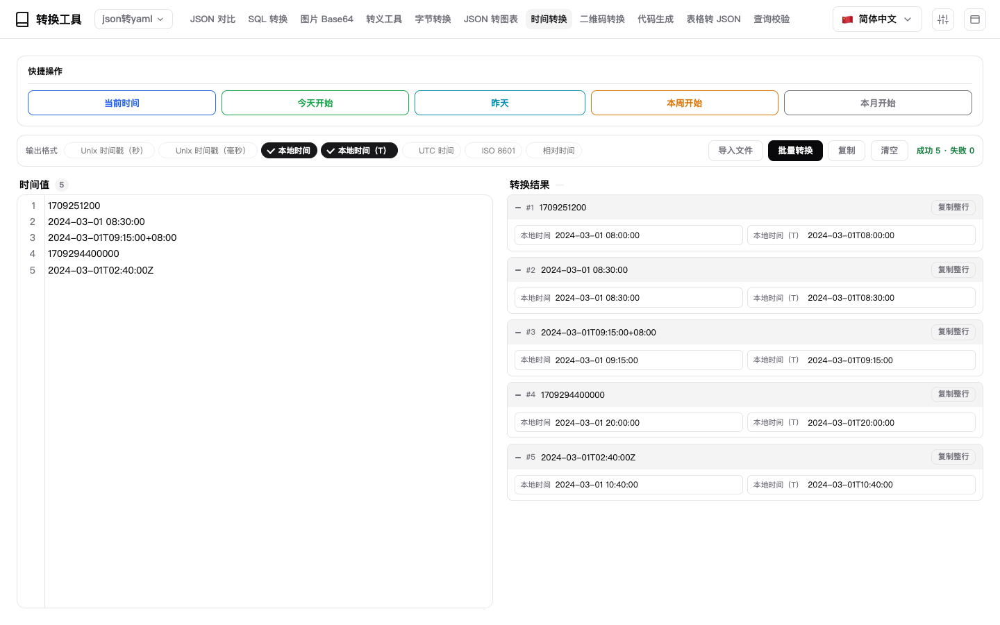

## Data stats

- **Paste a table, get the numbers** — drop delimited text on the left (Tab / pipe / comma / semicolon are sniffed, or pick one yourself) and the right pane shows the parsed preview on top and the statistics underneath, recomputed on every keystroke. A first-row-as-header switch is right there; turn it off and the first line counts as data.
- **The header is the column picker** — tick the columns you want and only those are measured. With nothing ticked the columns that look numeric are chosen for you, so pasting alone already produces a result. Seven metric chips toggle independently: count, sum, mean, max, min, distinct and standard deviation.
- **Group by any column** — the group dropdown follows the header; pick a column and each column is measured per group, one row per group and column, with groups in first-seen order rather than alphabetical. With no grouping you get the whole table at once.
- **Rows can be located** — the input is a line-numbered editor and the leftmost preview column is the **source line number** (the header is line 1, a leading blank line still counts). Click the line-number cell on the left and the caret jumps to that line; move the caret in the editor and the matching preview row lights up — exactly one row, scrolled back into view when it is off-screen.
- **Click a cell to copy it** — in both the preview and the result table, clicking any cell puts that cell's value on the clipboard: the pointer turns into a copy cursor, the cell flashes and a toast names what was copied. An empty group cell draws as an em dash but copies as an empty string, and a long value is ellipsized in the toast while the clipboard gets all of it. Clicking a data cell no longer drops the caret into the editor either, so the next paste never lands in your data.
- **Three copy targets** — **Copy columns (N)** copies as a table: a header row plus one record per line, tab separated, which pastes back into a spreadsheet as real columns. The small icon in a header copies every value of that column, one per line. **Copy result** emits the statistics together with the group column as TSV, ready for a report.
- **Show only the columns you care about** — the **All columns** dropdown in the top-right of the preview carries a checkbox per column; untick one and it disappears from the preview while the trigger reads **Columns 4/6**. One column always stays. Hidden is only about drawing: the statistics and the copy actions still use the whole table — to measure fewer columns, tick them in the header instead.
- Capped at 50k rows / 200 columns; beyond that only the first 50k rows are measured and the status line says so. The preview renders lazily in batches of 100 — one batch first, the next as you scroll near the bottom, with a **Load more** row at the end — while the statistics always use everything. Cells longer than 200 characters are clipped with an ellipsis in the preview, and the full value is what gets measured. Like every other text page it accepts a drop or the **Import file** button, and never switches page on you.

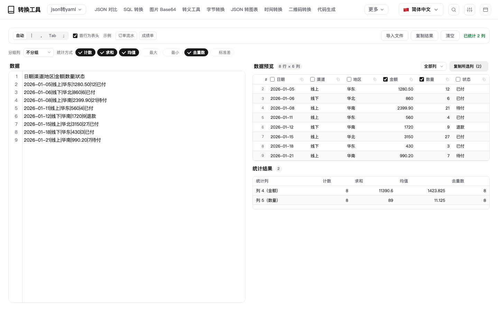

## SQL analysis

- **Paste a table and query it with SQL**: drop in delimited text on the left (Tab / pipe / comma / semicolon are sniffed, or pick one yourself) and toggle whether the first row is a header; turn it off and the columns are simply `c1..cN` (names are never guessed from values — guessed names follow no rule and just add vocabulary to remember). The data is parsed once; editing SQL never re-splits it.
- **Its own SQL engine, fully offline**: `SELECT` (expressions, `DISTINCT`, `AS` aliases), `WHERE` (`AND` / `OR` / `NOT` / `IN` / `LIKE` / `BETWEEN` / `IS NULL`), `GROUP BY` + `HAVING`, `ORDER BY` (multiple keys, `ASC` / `DESC`), `LIMIT` / `OFFSET`, plus `COUNT` / `SUM` / `AVG` / `MIN` / `MAX` / `GROUP_CONCAT` / `ROUND` / `ABS` / `UPPER` / `LOWER` / `LENGTH` / `TRIM` / `SUBSTR` / `COALESCE` / `IFNULL`. The host sandbox CSP has no `'wasm-unsafe-eval'` and `connect-src` is `none`, so duckdb-wasm (35–41 MB) cannot even start — the interpreter is plain JavaScript: no dependencies, no package growth, no network.
- **It never runs on its own, and never writes SQL for you**: changing data, switching the delimiter, clicking a sample, importing a data file, importing a `.sql` — all of them only put things in place. Running is your click on Run, `Ctrl / ⌘ + Enter`, or the context menu, and pressing Run on an empty pane just asks you to write a statement instead of inventing one. Typing settles for 220 ms and only refreshes column names, types and the preview — the status line no longer nags "changed, press Run", because the "Ran …" line above the result already names the statement that produced it.
- **The triangle in the gutter runs just that statement**: with a dozen statements in one pane, re-running one needs no selecting and no caret moving — click the triangle in front of it. It is drawn on the line holding the statement's first real character, so a statement preceded by a comment gets its triangle on the `SELECT` line, not on the comment.
- **Comments are comments**: both `--` and `//` are understood (`//` is additionally tinted like a comment, since CodeMirror's own SQL mode only knows `--`), `/* */` as always, and neither inside quotes counts. A stretch that holds only comments gets no triangle and is not treated as a statement to run; selecting just a comment and pressing Run lands on the statement below it; a semicolon inside a comment does not split anything.
- **The result says which statement produced it**: a "Ran + statement" line sits above the result table, ellipsized when long and shown in full on hover. Trailing semicolons and comments are left out, so the same statement never looks like two.
- **The statement you wrote is still there next time**: it is saved 800 ms after you stop typing, and again on page switch, tab hide or Run. Up to 24 KB it is stored as-is; anything larger is gzipped (the browser's own `CompressionStream`) and base64'd, and if it is still over 128 KB after compression it is not stored at all — a few hundred kilobytes of SQL should not eat the quota that keeps layout and theme remembered. Restoring never overwrites a pane that already has content (an imported `.sql`, a freshly pasted sample).
- **Less typing**: completion pops up as you type (columns / table `t` / functions / keywords), columns are listed right after `SELECT` and after a comma, and one Chinese character is enough to start matching — a middle fragment works too (`指标` → `考核指标`), with `Ctrl / ⌘ + Space` on demand. **Clicking a preview header inserts that column** at the cursor, adding `, ` automatically when it lands right after an identifier.
- **Right-click to run**: select a fragment and right-click → Run selected; with nothing selected it becomes Run current statement — when a pane holds several statements only the one under the cursor runs, no pre-selecting needed. The same menu has Clear SQL.
- **Snippets built from the current data**: all rows / group & aggregate / distinct / top 10 — columns, grouping key and sum column are chosen from the actual types (a text column with 2–15 distinct values is the grouping candidate, decimals win for sums, 0/1 flags and long IDs are skipped). Statements are **appended at the end** with a semicolon and a blank line, so the sentence you are halfway through never gets split.
- **Results you can see and take away**: row count and elapsed time in the status line, a badge spelling out "showing 500 / 4,321 rows", capped at 1000 rows and lazy-loading 100 at a time (plus a Load more row); click any cell to copy the value, Copy result produces the whole table as TSV; the column-type panel follows MySQL conventions, is editable and copies a `CREATE TABLE`.
- **The data pane previews as a table**: source / table views, the table view lazy-loads 50 rows at a time (max 2000), clicking a cell copies the value, columns are not stretched to fill the pane, numbers are right-aligned and the sticky header stays opaque.
- **One toolbar, three groups**: how to parse (delimiter / header), the snippets used to write SQL, and the run actions (Import SQL / Clear SQL / Run) share one row with thin dividers between the groups, with Run at the far right just above the editor; Import data / Clear data sit in the Data header, Copy result in the Query result header, and the samples are a dropdown on the Data header — everything lives on the pane it acts on.
- **Paste JSON straight in as data**: a response copied out of an API tool, or an exported log, is JSON — and it used to land entirely in the first column, one long line. Now a pane whose whole content is a JSON array is flattened into a table automatically: an array of objects `[{"region":"East","orders":12}, …]` takes the keys in order of first appearance as columns and leaves missing keys blank; `[["region","orders"],["East",12]]` takes its first row as the header; `[1,2,3]` is a single unnamed column. **Only the top level is taken** — a nested object or array becomes one cell holding its JSON text instead of being spread into `user.name` columns, because spread columns change with the data and the same query would break on the next response. After flattening the delimiter is pinned to Tab, the first row is pinned as the header, and the preview switches to the table view.
- **Import without choosing a format**: `.csv` / `.tsv` / `.txt` / `.json` / `.xlsx` come in through Import data (xlsx reads the first sheet, JSON is flattened, both end up as the same delimited text), `.sql` through Import SQL (or just drop a `.sql` on the window) — BOM and CRLF are normalised, nothing runs on import and the statement you are writing is left alone. A `.json` that does not hold an array (a wrapper like `{"data":[…]}`) reports "Bad data format: only a JSON array is accepted" rather than guessing which key to open — a wrong guess leaves you unable to tell what went wrong.
- **Several statements run one by one, and one failure does not stop the rest** — a pane may hold more than one statement; both `;` and the full-width `；` split them, and Run executes them in order, one tab per statement ("#1 / #2 / …"). A failing statement only turns its own tab red with "statement N: …" underneath, the rest still run, and the status line reports "2 succeeded, 1 failed". To run a single one, select it and use Run selected, or run the statement under the cursor from the context menu.
- **The supported surface is pinned by tests** — `WHERE` / `GROUP BY` / `HAVING` (aliases and aggregates both work), `ORDER BY` / `LIMIT … OFFSET`, `DISTINCT`, `IN` / `LIKE` / `BETWEEN` / `IS [NOT] NULL`, `AND / OR / NOT`, arithmetic and `||` concatenation; aggregates `COUNT SUM AVG MIN MAX GROUP_CONCAT` (including `COUNT(DISTINCT x)`), scalars `COALESCE IFNULL ROUND ABS FLOOR CEIL UPPER LOWER TRIM LENGTH SUBSTR` — 27 keywords and 18 functions, every one of them exercised in the regression suite.
- Caps are 50,000 rows / 2 M characters, with a note in the tip bar when you go over; like every other text page it accepts dropped files and never switches the page on you.

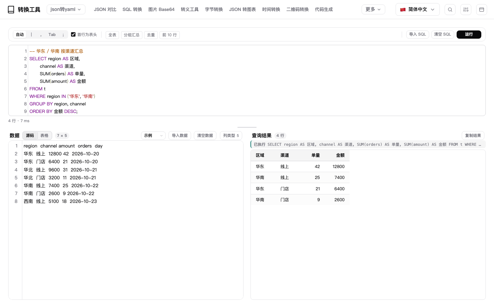

## JSON to Chart

- **Paste an option, get a chart** — drop a full **ECharts option** on the left (`title` / `xAxis` / `yAxis` / `series` / `dataset` all understood) and the right pane renders exactly that configuration: line, bar, pie, scatter, radar, treemap and every other ECharts chart type works. No API to memorise — copy an option from the official examples and look at it immediately.
- **Bare data is enough** — paste an array of numbers (`[820, 932, 901]`), an array of named objects (`[{ "name": "Jan", "value": 820 }]`), a mapping (`{"Jan": 820, "Feb": 932}`) or `[[x, y]]` pairs and the shape is detected and matched to a sensible type; the toolbar switches between line / bar / area / pie / scatter. For a full option the dropdown keeps working: **Auto** follows `series.type` from the JSON, and picking line / bar / area / pie / scatter overrides it (the first three just swap `series.type`, pie rebuilds from the category names plus the first series) — never leaving you with a blank canvas after a switch.
- **API responses need no unwrapping** — plenty of backends bury the option under a business key, as a string: paste `{"monthly_trend":{"echart_option":"{…}","table_data":null,"biz_data":{}}}` as it is. Keys such as `echart_option` / `chartOption` / `chart_config` / `option` / `data` / `result` are ranked together with the content, up to three layers are peeled, and a double-encoded string (JSON inside a JSON string) is decoded too. The status line says *Parsed from monthly_trend.echart_option* instead of silently swapping what you pasted.
- **Several charts in one JSON, or several JSONs at once** — when a response holds more than one chart (`{"a":{"echart_option":…},"b":{…}}`, `{"charts":[option, option]}`, sibling `option1` / `option2` keys) a **Chart** dropdown appears in the toolbar, listing them by title; picking one redraws. One JSON per line (NDJSON) or back-to-back `{…}{…}` is split as well, with paths shown as `#1…` / `#2…`, while one number per line merges into a single line chart.
- **Task-list exports work too** — the top level is an array, each task carries a field that is itself a serialized JSON string, and only after unwrapping that is it `business key → echart_option / table_data / biz_data`: six layers deep with thousands of table rows in between. Those charts are still found (paths look like `[0].payload.<business key>.echart_option`, and `null` options take no slot). The walk skips plain data rows and scales its budget with the input, so a huge table in front of the chart does not push it out; if an input really is too large to scan completely, the status line says *only the first part was scanned* instead of pretending that is all there is.
- **See the whole chart, then zoom in** — when the canvas does not fit the pane it is scaled down to fit (100% when it does), and the toolbar carries `−` / Fit / percentage / `+`: 1.25× steps, click the percentage for true 1:1, click Fit to go back. Zoom only changes what you see — the export and the conversion always use the pixels you typed. The Image ⇄ Base64 preview shares the same controls and scales proportionally, never stretched.
- **1:1 preview, never stretched** — the canvas is drawn at exactly the pixels in the size fields, with no CSS scaling (what you see is what you export). When it is wider than the pane the stage scrolls, and the left edge is reachable — the previous centred layout pushed the left half out of view where it could not be scrolled back.
- **The size is whatever you type** — the default is **700 × 400** (landscape, matching echarts-node-export-server), and changing the fields (80–4096) moves the preview *and* the export together, WYSIWYG. Out-of-range values are clamped to the bound, written back into the field and explained. Made a mess of it? **Reset size** puts 700 × 400 back.
- **Pixel ratio decides how sharp the export is** — the toolbar's **Pixel ratio** offers **1x / 2x / 3x**, i.e. the render-time `devicePixelRatio`: 1x is exactly the width and height you typed, 2x / 3x produce larger bitmaps that stay crisp in documents and print. Each option states the pixels it will yield (`2x · 1400 × 800`), the export button's tooltip repeats it, and the file name gets an `@2x` / `@3x` suffix so you can tell at a glance. Beyond 24 megapixels (say 4096 × 4096 at 3x) the ratio is stepped down automatically so the host canvas is never blown up.
- **Export PNG / SVG** — PNG comes out at width × pixel ratio, rendered through a throwaway instance created with that `devicePixelRatio` and `animation: false`, so the result never depends on how the on-screen canvas happens to be zoomed. SVG goes through ECharts' `renderToSVGString()`. Both save as files: through the host save channel inside DBX, falling back to a browser download when you open `index.html` directly. Export **ignores the interface theme**: even in dark mode the chart is drawn with ECharts' default (light) palette on a white background, so the preview and the exported file are always the same image — a chart is meant to be pasted somewhere else, where a themed background would look wrong.
- **Zoom to inspect** — **Zoom in** (or a double-click on the canvas) opens the whole chart in a full-screen lightbox: wheel zooms at the cursor, double-click toggles 1:1 and fit, `+` `−` `0` `1` are shortcuts, `Esc` closes. The lightbox renders at the selected pixel ratio too, so 300% still looks sharp. The Image ⇄ Base64 preview shares the same lightbox.
- **Failure is explained** — bad JSON, an unrecognised shape, too many points (20k per series / 50k total), too many series (30) or a chart engine that did not load each get their own message instead of a blank canvas.
- The chart engine (ECharts 6.1.0) **ships offline** and is only loaded the first time you open this page, so the first paint never pays for it. It is not pulled through an external script tag — the engine travels as inert text and is turned into a `blob:` URL on demand, which no sandbox CSP can block. Leaving the page releases the canvas and the instance right away.

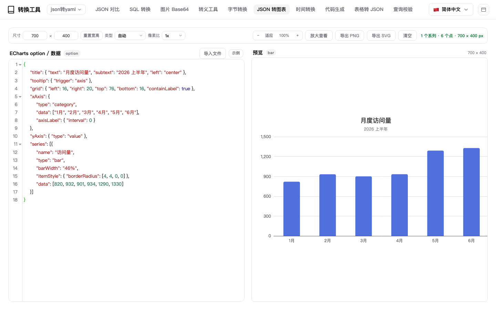

## QR code

- **Batch in, batch out** — one line becomes one code: a column of links, ids or any short text turns into a wall of codes in one press, numbered down the side, and an empty line never becomes a blank code. Switch the split to **whole block** and the line breaks stay inside a single code (postal addresses, JSON snippets, multi-line notes), with only the leading and trailing blank lines trimmed.
- **The code is made of settings** — size (128–1024 px, 256 by default), margin (0–8 modules), error correction (L / M / Q / H) and foreground / background colours, picked from a colour picker or typed as `#rrggbb`. A foreground too close to the background raises a warning up front instead of handing you a code nobody can scan.
- **A centre icon, with the correction level tuned for it** — pick an image and it is normalised to a 256 px PNG and drawn in the middle over a rounded white pad. The error correction jumps to **H** by itself, because that is the level at which a code with a hole in the middle still decodes; L / M / Q do not. Set it back by hand and the tip line says it may no longer scan.
- **PNG or SVG** — PNG for sharing, SVG for print: every run of dark modules on a row is merged into one path line, so even 200 codes do not weigh the DOM down. A single export opens a small panel where **format, size and file name are settled on the spot** (PNG / SVG, 256 / 512 / 1024 or any 128–1024, rename as you like — Enter saves, and the next card remembers the choice); text copies on its own, and **Copy image** puts the picture on the clipboard through `ClipboardItem`; **Export all** tiles every code into a single `qr-codes.png` sized to a near square, instead of opening 200 save dialogs.
- **Double-click to zoom in** — double-clicking a code opens it in the lightbox: full screen, wheel zoom towards the cursor, double-click toggles fit / 1:1, `Esc` or a click on the backdrop closes it. The picture inside is redrawn as vector at 1024 instead of the small card image stretched, so it stays sharp at 147%; the title reads "first line · 1024 × 1024" so you know which code you are looking at. The lightbox is shared with the image page.
- **Folded, and tied to the line it came from** — a card folds down to its number plus a one-line preview (`+` / `−`), and clicking a card (or its number) puts the cursor back on the line that produced it, so a long list stays navigable in both directions.
- **Decode pictures back into text** — the second tab takes dropped images, pasted screenshots or a whole batch of files, decodes them one after another (each scaled to a 1600 px long edge and released immediately) and lists the text with a copy button. Single codes and batches both work, and content that had line breaks comes back with them.
- Both engines (qrcode-generator and jsQR) **ship offline** and travel as inert text that becomes a `blob:` URL when the page opens — the decoder (251 KB) only loads when you actually switch to that tab. Text is encoded as UTF-8, so Chinese content decodes correctly instead of turning into mojibake.

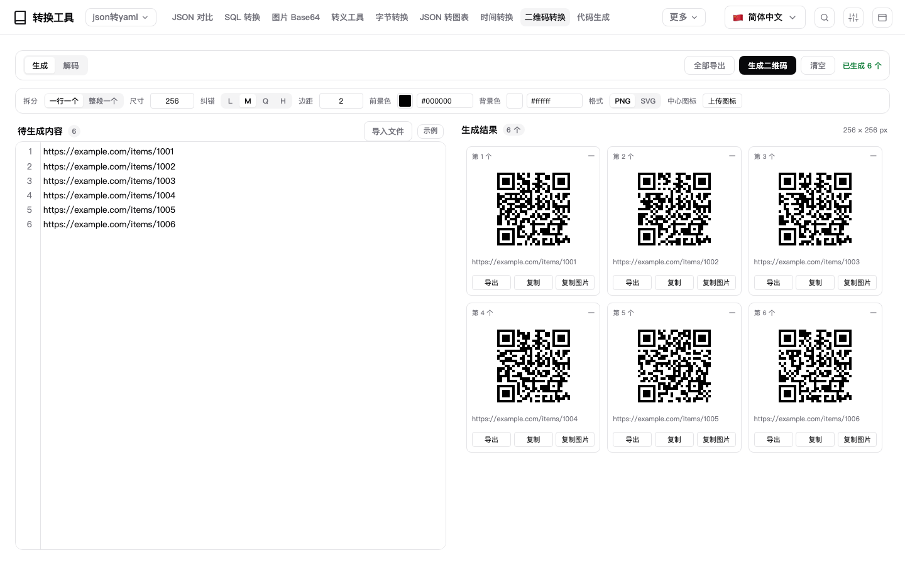

## Workflow

- **Every page can import a file, and the page never moves** — whichever page you are on, the file is handled by that page. The whole window is a drop target (the veil even states the size limit for this page), and the Import file button in the input pane goes through exactly the same channel. On Convert, `.json` / `.yaml` / `.xml` / `.toml` / `.ini` / `.env` / `.log` / `.md` / `.csv` / `.tsv` set the source format and convert straight away, and unknown extensions (`.dat` / `.out` / `.resp` exports) are read and sniffed just the same; the Compare page has its own Import left / Import right buttons, and a dragged file fills whichever side is still empty; SQL, Escape, Bytes, Time, Stats, Chart, Codegen and Query each take their own text and run their own rule right after import, and QR code takes text for generation and pictures for decoding. Images and spreadsheets are never read as garbage: dropped on a text page they only tell you to use Image ⇄ Base64 or Sheet → JSON — **the page is never switched for you**.
- **The limits are stated up front** — 16 MB per text file (10 MB for an image, 20 MB for a sheet). Over the limit is refused at the door with the actual size and the cap, before anything is read into memory; content that turns out to be binary (NUL bytes / a wall of replacement characters) is refused too. After an import the tip line keeps `file name · size`, and text over 2 M characters is loaded but not auto-converted (so a drop can never freeze the host) — press Convert when you are ready.
- **Drop several sheets at once** — up to 10 files are parsed with the current options and merged into **one JSON object keyed by file name** (`{"a.csv": [...], "b.csv": [...]}`), with duplicate names numbered `a (2).csv`. The preview table shows the first file, and Copy / Export work on the merged result (`batch-2.json`).
- A page's own drop zone and the window-wide entry share one rule: the Image page's zone catches the image first (page-level handlers run before the global one, which steps aside when the event was already handled), and dropping anywhere else still hands the file to the current page — same outcome either way.
- Drops go through the host channel: the DBX window is a Tauri / WebView host, which takes system file drops before the page ever sees a native `drop` event. The plugin uses `dbxPlugin.fileTransfer.onDrop` to get a `handleId`, reads the content back in 256 KB chunks, and drives the overlay from `onDragState`. Opening `index.html` directly falls back to browser events, so both paths work.

## Editor selection menu

- **Select something in any editor, right-click, done** — all fourteen pages share one menu, so you no longer copy text out and hunt for the tool page. The header says what the action applies to (`3 lines · 128 chars`), or "Nothing selected" — in which case everything except Copy / Paste / Select all is greyed out, so "copy one line" can never quietly copy the whole document.
- **Results go to the clipboard, never into your text** — encode / decode, cleanup and SQL generation all compute a result and write it to the clipboard; not one character of the editor changes. The single exception is Paste image, whose whole point is insertion.
- **Basics** — copy (selection, or the whole document when nothing is selected), cut, paste, select all, with `⌘C` / `Ctrl+C` hints that match the platform.
- **Escapes** — Base64 / URL / JSON string / newline encode & decode on the main menu; HTML / `\uXXXX` / Hex / SQL literal / regex under "More escapes". Labels reuse the Escape toolbox's own terminology in all 14 languages instead of inventing a second set of names.
- **Cleanups** — trim each line, strip all whitespace, remove duplicate lines, sort, reverse, JSON pretty-print / minify (pretty-printing reflows tokens, so an 18-digit id like `120101000001417742` never gets its last digit rewritten by `Number`), plus "More cleanups": numeric sort, line numbers (zero-padded to the widest number), upper / lower / title case, "Join into one line" (comma / ideographic comma / space) and "Wrap in quotes" (single / double / backtick, with the same quote doubled inside).
- **Build SQL** — a selected column of values becomes `IN (…)` / `NOT IN (…)` / `INSERT INTO … VALUES …`, with `your_table` as the placeholder table; the split rules are the same ones the SQL builder page uses (ideographic comma, full-width comma and pipes all count), and duplicates are removed by default.
- **QR code** — copy the selection as a 512×512 PNG (error correction M, pure black on white, margin 4 — fixed on purpose so the result is predictable). Content beyond one symbol's capacity is greyed out per error-correction level, with the QR page for batch generation. Where the image clipboard is out of reach (the DBX host is such a place), the menu item and the QR-page button say Save as PNG / Save image and write a file instead — no pretending, no surprise save dialog.
- **Paste image** — an image on the clipboard becomes plain Base64 / a Data URI / an `` tag at the cursor (replacing the selection when there is one). The image is fetched in order of reliability: standard `clipboard.read()` → host `clipboard.readImage()` → a `paste` event as the last resort; if the first two are refused the menu says "press ⌘V" instead of silently doing nothing. Above 2 MB it asks first, above 10 MB it refuses.
- **Keyboard works** — `↑↓` move (skipping separators and disabled items), `→` opens a submenu, `←` closes it, `Enter` runs, `Esc` dismisses, and keys pressed while the menu is open never reach CodeMirror. The menu opens at the pointer and is nudged back inside the viewport; a submenu that does not fit on the right flips to the left.
- **Long menus still scroll** — the main menu is height-capped and scrolls internally (scrollbar hidden; wheel and arrow keys both work), and scrolling inside the menu never dismisses it. Scrolling the page, resizing or clicking elsewhere does.
- **The SQL analysis page keeps its own menu** — its "Run selected / Run current statement / Clear SQL" are page-specific, so the shared menu steps aside (`EditorMenu.exclude`) and right-clicking there behaves exactly as before.

## Everywhere

- **Internationalization** — 14 languages: zh-CN, zh-TW, en, ja, ko, es, id, it, pl, pt, ru, th, tr, az. Every page (convert, compare, SQL, sheet, data stats, SQL analysis, image, code gen, query, escape, bytes, time, chart, QR code) is translated into all 14, including the 20 schema-validation messages.
- **Theme adaptability** — follows the DBX host theme and shadcn/ui tokens, including hosts that only send theme metadata (no `data-dbx-theme`) and custom palettes. First paint already matches the host, theme switches cross-fade over 300 ms, and `prefers-reduced-motion` turns the animation off. The one exception is the chart itself on the JSON to Chart page: it is output, not interface, so it stays on the light palette with a white background.
- **Navigation layout** — the button at the far right of the top bar moves the navigation between top and left, top by default. On the left the twelve entries stack into one 13rem column and the content area shifts over; the conversion picker sits at the top of that column too and expands inside it, pushing the entries down instead of covering them. The column fits every entry, so "More" never appears. A button beside the title folds the column away and brings it back, and the divider between column and content stays a single unbroken line while the column scrolls as one piece. The choice is remembered — host `dbxPlugin.storage` first, then browser `localStorage`, then `window.name` (the only channel that works inside the `dbx-plugin dev` sandbox) — so reopening keeps the last layout.
- **Search** — the magnifier in the top bar (or `⌘K` on macOS, `Ctrl+K` elsewhere) opens search. In the left layout the field sits in the top bar all the time; in the top layout there is no room, so while you search the bar lends the navigation row to the field (the entries fold away and come back the moment you leave) — the field therefore always lives inside the top bar and **never floats over the page or the format toolbar**. Chinese, English, synonyms, full pinyin and initials all match: `sj` / `shijian` / `unix` / `时间戳` all lead to the Time converter, `bt` / `对比` / `diff` to JSON Compare, `jiami` / `encode` to the Escape toolbox. Formats are in the index too — `toml`, `从 toml`, `转为 toml` list the conversion directions individually and land on the Convert page with the right side already set. So are the tabs inside each page: `转图片` lands on the Image page with Base64 → image already selected, `INSERT` / `Schema` / `Go` jump straight to that template, validator or language, and a repeated name like `解码` shows both owners on the right. Results are ranked pages → directions → tabs → formats, so a word like `json` never buries the page under format entries. Arrow keys move, Enter opens (picking calls the navigation handler directly, so it works inside the host webview as well), Esc closes; a keystroke that belongs to a Chinese input method is never stolen — nothing is re-rendered or cleared while a composition is in progress, which is what keeps the candidate window alive in the host's WebKit view.
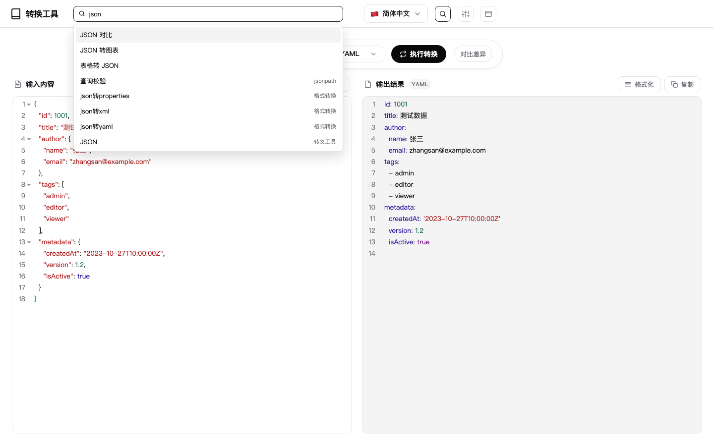

- **Order, pins, and a sticky bar** — the sliders button in the top bar opens Navigation settings: drag a row or use the arrows to order the thirteen entries, and pin the ones you use most (JSON Compare and SQL Conversion start pinned). Order and pins apply at once, and pinned entries are the last to fall into More when the window narrows; Sticky navigation bar keeps the bar at the top while content scrolls, and in the left column pinned entries stay glued to the top as the column scrolls. These settings travel with the layout choice (host `dbxPlugin.storage` → `localStorage` → `window.name`), live under their own `navCustom` key with a format version, and fields a build does not understand are passed through untouched — so downgrading and upgrading again keeps your setup. New entries need no migration: they are appended to the end of the order and can be dragged where you want them.
- **Picks up where you left off** — whichever entry you opened last (a page, or a pair of formats such as `csv` → `json`) is remembered, and the next launch lands right there instead of starting over on the convert page. Stored under its own `lastFeature` key through the same four-level storage as the layout and nav order. The record is just a `v` plus a couple of fields, so **downgrading or upgrading is safe**: unknown shape, missing fields or broken JSON all count as "never saved" and never jump to an entry that no longer exists; ids are checked against the live page, so a renamed or removed entry quietly leaves you on the default page; fields written by a newer version are passed through untouched, so an older build never wipes them.
- **Clipboard** — one-click copy through the DBX host API, with a browser fallback.
- **Icon-only buttons explain themselves** — search, fold the column, navigation settings and the layout switch are icons; hovering (or focusing) any of them shows a one-line tip in the current language. The webview does not reliably draw native `title` bubbles, so the tip is drawn by the page and takes its text from the button's `aria-label`.
- **Offline** — no backend, no CDN, no telemetry; CodeMirror, the YAML library and ECharts (Apache-2.0, `ui/vendor/echarts/` with its LICENSE) all ship inside the package.

## Prerequisites

- [Node.js](https://nodejs.org/) 22+
- [DBX Plugin CLI](https://www.npmjs.com/package/@dbx-app/plugin-cli)

## Quick start

```bash
git clone <repo-url> && cd dbx-plugin-data-convert
./scripts/build.sh dev          # workbench on port 5190 (PORT=n to override)
```

## Build & test

```bash
./scripts/build.sh test         # all suites (1318 cases)
./scripts/build.sh              # run tests, then package dist/*.dbxp
./scripts/run.sh                # shorthand for `build.sh dev`

npm test                        # pure-function suites, no dependencies (1318 cases)
npm install && npm run test:ui  # jsdom smoke test of the UI wiring (335 checks)

node scripts/shoot-screens.js   # re-shoot the fourteen README screenshots into docs/
```

Every push and pull request runs the same set on GitHub Actions: `npm ci` → `npm test` (all 23 pure-function suites) → UI smoke → manifest and inline-script checks.

On Windows use `scripts\build.cmd` instead (requires Git Bash).

### Project layout

```
ui/index.html          markup only — pages, dialogs, script tags (1.5 k lines)
ui/css/app.css         all styling — tokens, layout, per-page rules
ui/js/app/00-i18n-dict.js      i18n dictionary for every page
ui/js/app/01-host.js           host bridge: theme, storage, clipboard, file save
ui/js/app/02-lang-menu.js      language switcher
ui/js/app/03-nav-overflow.js   folding entries into "More"
ui/js/app/04-i18n-apply.js     applying translations to the DOM
ui/js/app/05-nav-layout.js     top / left column, collapse
ui/js/app/06-nav-panel.js      navigation settings: order, pins, sticky
ui/js/app/07-tip.js            hover tips for icon-only buttons
ui/js/app/08-nav-search.js     feature search: keys, pinyin, initials, formats
ui/js/app/09-convert.js        convert page
ui/js/app/10-diff.js           JSON compare page
ui/js/app/11-compare.js        text compare page
ui/js/app/12-sql.js            SQL builder page
ui/js/app/13-sheet.js          sheet → JSON page
ui/js/app/14-image.js          image ⇄ Base64 page
ui/js/app/15-codegen.js        code generation page
ui/js/app/16-query-escape.js   query & validate + escape toolbox pages
ui/js/app/17-stats.js          data stats page
ui/js/app/18-flow.js           workflow: drop routing, batch merge, recent list
ui/js/app/19-datasql.js        SQL analysis page (editor, engine wiring, draft memory)
ui/js/app/20-last-feature.js   remembers the last feature and restores it on launch
ui/js/app/21-editor-menu.js    editor selection menu: placement, keys, clipboard, images, QR
ui/js/selectconv.js    selection conversions — escapes / cleanups / SQL, pure functions, no DOM
ui/js/converters.js    conversion core — pure functions, no DOM, unit tested
ui/js/objdiff.js       structured diff — compares object trees by JSON Pointer
ui/js/diff.js          line diff — ops carry line numbers, degrades on huge input
ui/js/sqlgen.js        SQL generator — batch-text parsing + IN/NOT IN/INSERT rendering
ui/js/sheetconv.js     CSV/TSV → records → JSON — delimiter sniffing, types, limits
ui/js/xlsxread.js      .xlsx reader — ZIP + DecompressionStream + XML scan, no deps
ui/js/imgconv.js       image ↔ Base64 — magic-byte sniffing, normalisation, SVG text
ui/js/codegen.js       code gen — type inference + DDL parsing + 4-language renderers
ui/js/confconv.js      format matrix — TOML / INI / .env / CSV / TSV / Query / Headers / Cookie / HTML
ui/js/jsonpath.js      JSONPath + jq subset — one parser, two dialects, result paths
ui/js/schema.js        JSON Schema draft-07 subset — validation errors + inference
ui/js/escape.js        8 escape kinds — URL / Base64 / HTML / JSON / Unicode / hex / SQL / regex
ui/js/bytes.js         byte conversion — units ⇄ bytes, batch totals, hex dump / byte array / binary
ui/js/chart.js         JSON to chart — shape detection, data → option, size clamping and limits
ui/js/time.js          time conversion — timestamps / dates / UTC / ISO / relative, batched
ui/js/qr.js            QR code — matrix generation, SVG / canvas rendering, tiling, decode helpers
ui/js/flow.js          workflow — pure helpers: size limits, sniffing, batch merge, recent list
ui/js/nav.js           navigation — pure helpers: order, pins, effective order, last-feature archive
tests/                 regression suite, run with plain node
scripts/build.sh       package | dev | test
scripts/shoot-screens.js  headless-Chrome screenshots for docs/
```

`ui/js/app/*.js` are classic scripts sharing one top-level scope (the sandbox only allows inline and
`blob:` scripts, so ES modules are out; wrapping each file in an IIFE would just recreate the
monolith). That means no hoisting across files — a file only defines things and wires events after
`DOMContentLoaded`, so adding a page is one new file plus one `<script>` tag.

The logic layers are deliberately DOM-free, so `node tests/*.test.js` exercises every converter,
the diff algorithms, sheet parsing and Base64 round-trips without a browser.
