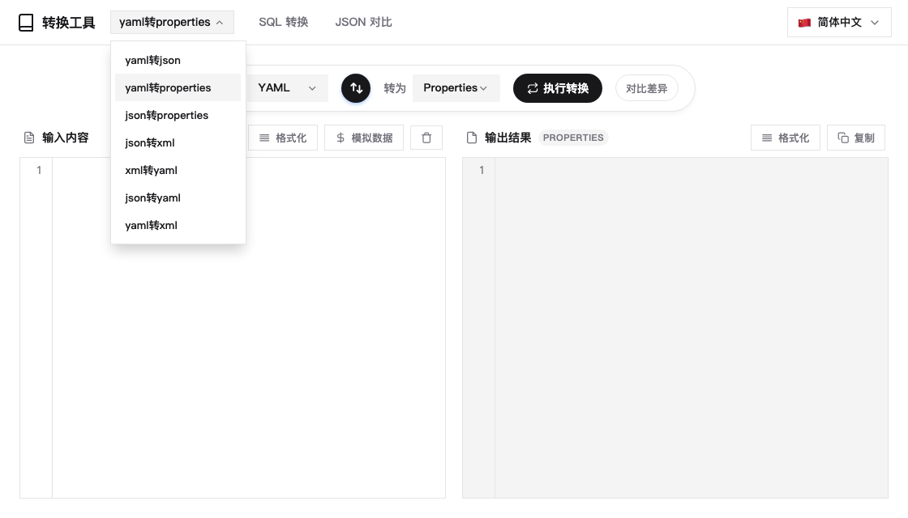
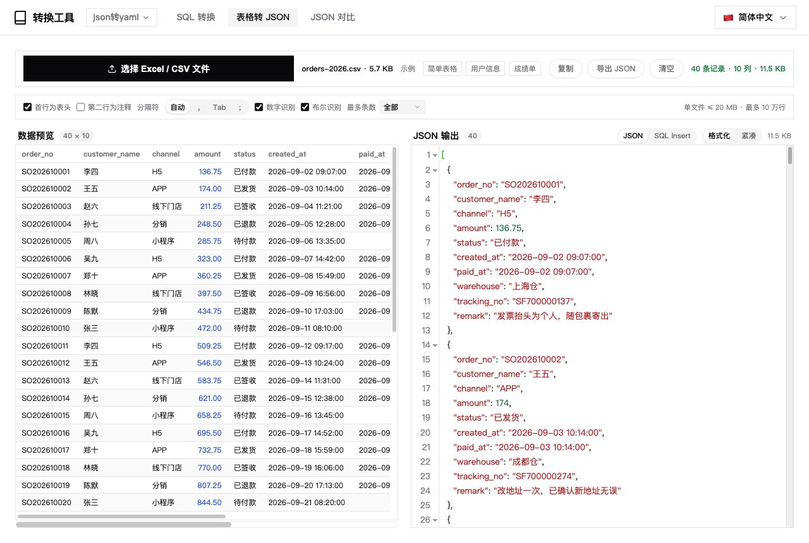
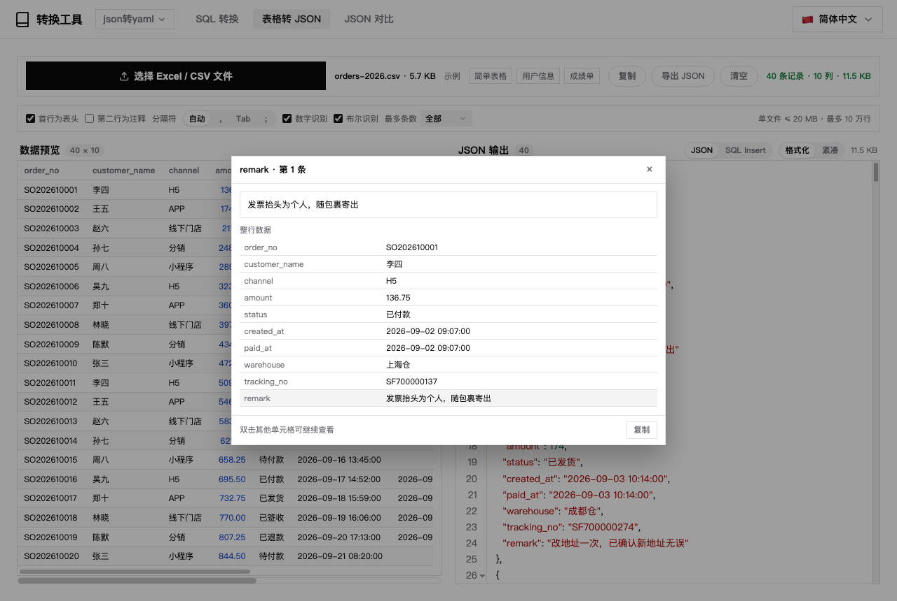
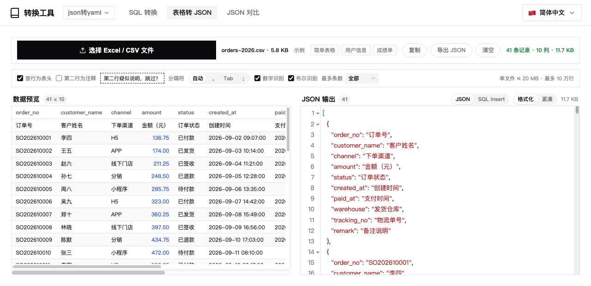
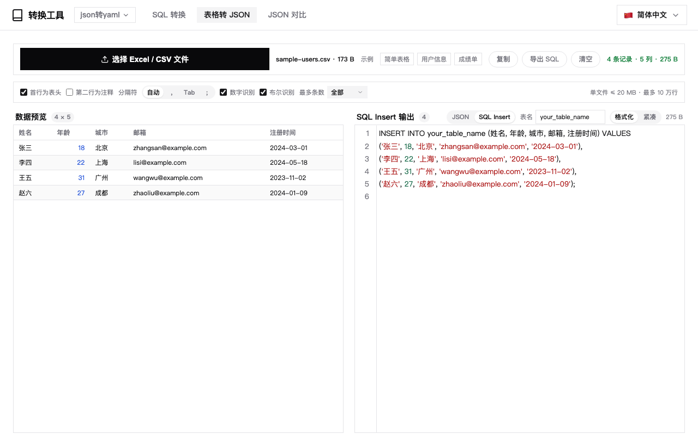
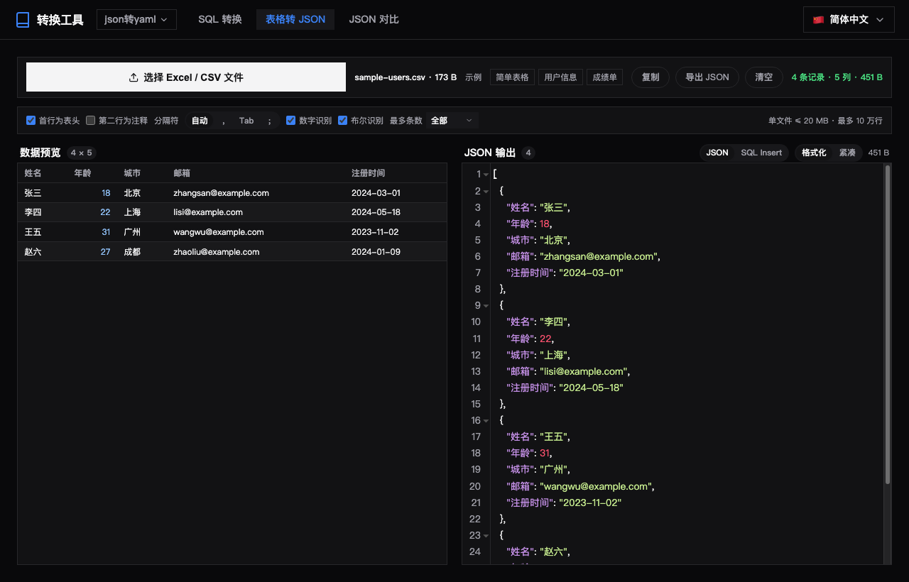

# 数据转换 (Data Format Converter)

A [DBX](https://dbxio.com) plugin providing seamless conversion among JSON, YAML, XML, and Properties formats. Built with a **Frontend only (universal)** template, producing a single cross-platform `universal` package without any native backend.


[中文文档](README.zh-CN.md)

## Features

- **Multi-Format Support**: Seamless conversion among JSON, YAML, XML, and Properties.
- **No Backend Required**: Runs entirely in the frontend (Vanilla JS) within the DBX host environment.
- **Mock Data Generation**: Built-in mock data generator for quick testing and schema design.
- **Format Validation & Formatting**: Auto-formatting for JSON, YAML, and XML strings.
- **Structured diff**: compares two versions field by field (JSON Pointer), highlights only the values that actually changed, and lists every change in a floating report.
- **JSON compare page**: a dedicated entry in the nav bar — paste one JSON per side, click Compare, and every differing value is highlighted with a "N differences" summary. Ships with four samples and a free-text mode.
- **Free-text compare**: in text mode the samples switch to Markdown, config file, HTML snippet and log output. Lines are compared row by row — removed lines get a red band plus a red edge bar, added lines a green band plus a green edge bar, with no strikethrough so code stays readable. The tip reports "N different lines", and suggests JSON compare when both sides are valid JSON.
- **SQL builder page**: a separate entry in the top nav. Paste one value per line (commas, semicolons and tabs work too) and get SQL on the right: `IN (...)`, `NOT IN (...)`, a plain value list, or `INSERT INTO ... VALUES ...;`, in single-line or one-per-line form. Single quotes, double quotes or no quoting; numbers are quoted by default (`'31010100003922409'`), with a toggle to emit bare numbers so `int` columns keep their index; toggles apply immediately, duplicates are dropped and both counts are shown. Pasting a whole `WHERE id IN ('a','b')` or `INSERT ... VALUES ('a'),('b')` fragment parses back into clean values. Generates as you type, one-click copy.
- **Sheet to JSON page**: drop in an `.xlsx`, `.csv` or `.tsv` and get a JSON array. The first row becomes the keys (switchable), the delimiter is sniffed (and can be pinned to `,` / Tab / `;`), numbers and booleans are inferred (`007` and 15+ digit ids stay strings), short rows are padded and duplicate headers get a `_2` suffix. Excel dates come through as `2024-03-01`, shared strings / inline strings / booleans / error cells are handled too. A preview table shows the parsed rows, the output panel is read-only with copy and export, and large files stay responsive: 20 MB / 100k rows caps, a 500-row preview, chunked serialisation with a progress bar, and a cancel token so a slow file never overwrites a newer one. The export button saves through the host `fileTransfer` channel (falling back to `<a download>` when unavailable), a **Max records** selector converts only the first N rows, the output can be **JSON (fully indented / one record per line)** or **SQL Insert** (batched 500 rows per statement, ``-escaped, `.sql` export), and ZIP64 xlsx files are read correctly.
- **Optional "row 2 is a note" skip**: some sheets carry a Chinese description row under the English header row (`id / method` over `编号 / 请求方法`), which used to parse as a data record. A dedicated toggle now skips it — off by default — and a heuristic that spots "row 2 looks like a note" (ASCII header row, mostly non-ASCII note row, no numbers) only *suggests* it with a clickable hint, so the output never changes behind your back.
- **Horizontal scrolling + double-click details**: with many columns the preview table now sizes to its content instead of squeezing every column into the pane, and a persistent (draggable) horizontal scrollbar sits underneath — macOS overlay scrollbars stay invisible until you scroll, which made wide tables look truncated. Double-click any cell to open a detail card with the full untruncated value plus every column of that row, and a copy button.

- **One "Convert" dropdown in the nav**: the seven format pairs live in a single dropdown, and the trigger shows the pair in use (e.g. `yaml转properties`) instead of a generic label; the active pair is highlighted and `Esc` or a click outside closes it, leaving `Convert / SQL Builder / JSON Compare` on the bar. Whatever still does not fit folds into "More", so there is never a horizontal scrollbar.
- **Internationalization (i18n)**: Multi-language UI support including zh-CN, zh-TW, en, ja, ko, es, id, it, pl, pt, ru, th, tr, az.
- **Theme Adaptability**: Dark mode support that follows the DBX host theme and shadcn/ui design tokens. It still works when the host only sends theme metadata without writing `data-dbx-theme` (the plugin infers light/dark and switches editor syntax themes itself), and custom palettes such as warm-toned skins are honoured too. Switching themes cross-fades the whole page over 300ms (backgrounds, text and borders move together; the editor's syntax colours flip at the midpoint), paints in the host theme on first frame without a white flash, and respects `prefers-reduced-motion`.
- **Clipboard Integration**: One-click copy for converted results via DBX Host API or browser fallback.















## Prerequisites

- [Node.js](https://nodejs.org/) 22+
- [DBX Plugin CLI](https://www.npmjs.com/package/@dbx-app/plugin-cli)

## Quick Start

```bash
git clone <repo-url> && cd dbx-plugin-data-convert
./scripts/build.sh dev          # start the workbench on port 5190 (PORT=n to override)
```

## Build & Test

```bash
./scripts/build.sh test         # converter + diff + SQL generator + sheet parsing + SQL insert tests (160 cases)
./scripts/build.sh              # run tests, then package dist/*.dbxp
./scripts/run.sh                # shorthand for `build.sh dev`

npm test                        # converter + diff + SQL generator + sheet parsing (no dependencies)
npm install && npm run test:ui  # jsdom smoke test of the UI wiring (93)
```

On Windows use `scripts\build.cmd` instead (requires Git Bash).

### Project layout

```
ui/index.html          UI shell: layout, styles, wiring
ui/js/converters.js    conversion core — pure functions, no DOM, unit tested
ui/js/objdiff.js       structured diff — compares object trees by JSON Pointer
ui/js/diff.js          line diff — ops carry line numbers, degrades on huge input
ui/js/sqlgen.js        SQL generator — batch-text parsing + IN/NOT IN/INSERT rendering
ui/js/sheetconv.js     CSV/TSV → records → JSON — delimiter sniffing, types, limits
ui/js/xlsxread.js      .xlsx reader — ZIP + DecompressionStream + XML scan, no deps
tests/                 regression suite, run with plain node
scripts/build.sh       package | dev | test
```

The conversion core is deliberately DOM-free: `node tests/converters.test.js` exercises all 12
format pairs plus edge cases without a browser. `node tests/diff.test.js` verifies that every
diff step points back at the real source line, including the large-input fallback.
