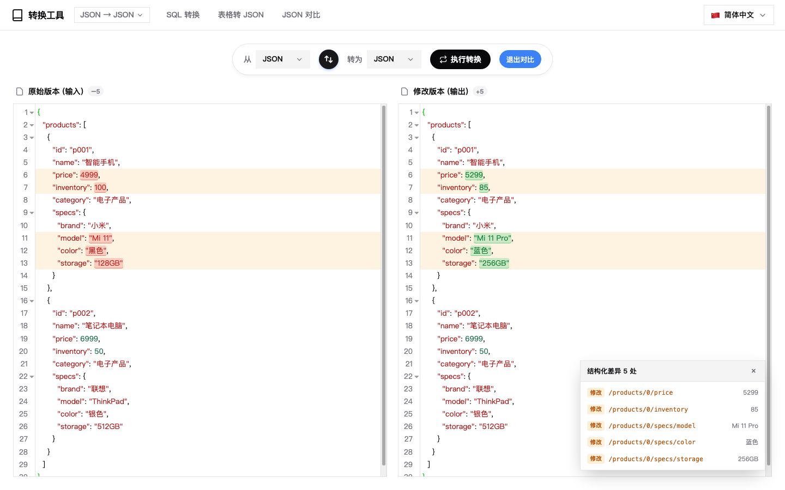
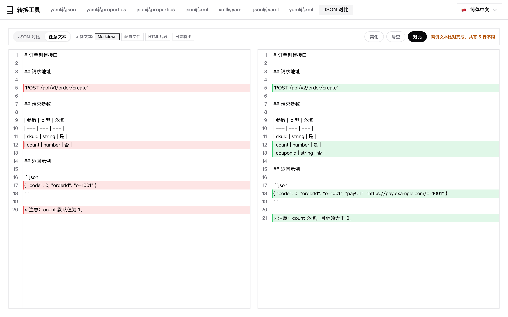
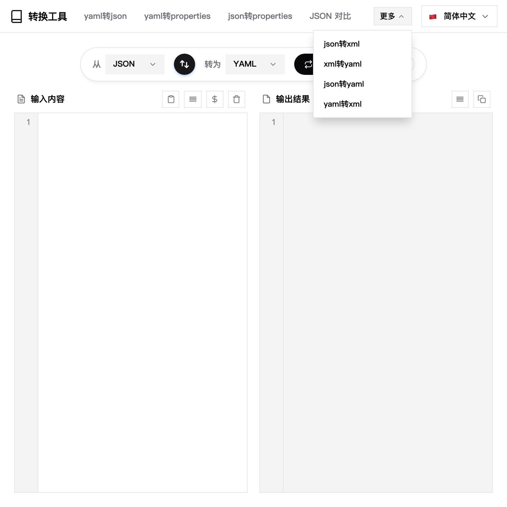

# 数据转换 (Data Format Converter)

一个 [DBX](https://dbxio.com) 插件，提供 JSON、YAML、XML 和 Properties 格式之间的无缝转换。采用 **纯前端（通用）** 模板构建，生成单个跨平台的 `universal` 包，无需任何原生后端。


## 功能特性

- **多格式支持**：JSON、YAML、XML 和 Properties 之间的无缝转换。
- **无需后端**：完全在 DBX 宿主环境的前端（Vanilla JS）中运行。
- **模拟数据生成**：内置模拟数据生成器，用于快速测试和 Schema 设计。
- **格式校验与美化**：自动格式化 JSON、YAML 和 XML 字符串。
- **结构化差异对比**：按字段（JSON Pointer）比较两版数据，只高亮真正变了的那个值，并在右下角列出变更清单。
- **JSON 对比页**：导航栏独立入口，左右两栏各贴一份 JSON，一键标出所有不一致的值并给出「共 N 处」提示，另附 4 组示例与「任意文本」模式。
- **任意文本对比**：切到该模式后示例换成 Markdown / 配置文件 / HTML 片段 / 日志输出四组真实文本，按行对比——删掉的行整行淡红底 + 行首红条，新增的行整行淡绿底 + 行首绿条（不划删除线，代码也读得清），底部提示「共 N 行不同」；两侧都是 JSON 时会提示改用「JSON 对比」。
- **导航溢出收进「更多」**：导航项放不下时不再出现横向滚动条，末尾几项自动收进「更多」下拉；窗口拉宽、切换语言后自动复原，`JSON 对比` 优先留在导航条上。
- **国际化 (i18n)**：支持多语言 UI，包括 zh-CN、zh-TW、en、ja、ko、es、id、it、pl、pt、ru、th、tr、az。
- **主题适配**：支持深色模式，自动跟随 DBX 宿主主题及 shadcn/ui 设计令牌——即使宿主只下发主题信息、没有写 `data-dbx-theme`，也会自行判定明暗并切换编辑器语法主题；自定义调色板（含暖色皮肤）同样生效。
- **剪贴板集成**：通过 DBX Host API 或浏览器降级方案，一键复制转换结果。








## 环境要求

- [Node.js](https://nodejs.org/) 22+
- [DBX Plugin CLI](https://www.npmjs.com/package/@dbx-app/plugin-cli)

## 快速开始

```bash
git clone <repo-url> && cd dbx-plugin-data-convert
./scripts/build.sh dev          # 启动本地工作台，默认端口 5190（PORT=n 可覆盖）
```

## 构建与测试

```bash
./scripts/build.sh test         # 转换核心 + 差异算法回归用例（72 条）
./scripts/build.sh              # 先跑用例，再打包 dist/*.dbxp
./scripts/run.sh                # 等价于 build.sh dev

npm test                        # 只跑转换核心与差异算法，无第三方依赖
npm install && npm run test:ui  # jsdom 页面接线冒烟（43 项）
```

Windows 下使用 `scripts\build.cmd`（需要 Git Bash）。

### 目录结构

```
ui/index.html          UI 外壳：布局、样式、事件装配
ui/js/converters.js    转换核心 —— 纯函数、无 DOM 依赖、可单测
ui/js/objdiff.js       结构化差异 —— 按 JSON Pointer 比较对象树
ui/js/diff.js          逐行差异 —— 带行号的 ops、超限自动降级
tests/                 回归用例，直接 node 运行
scripts/build.sh       package | dev | test
```

转换核心与 DOM 解耦：`node tests/converters.test.js` 无需浏览器即可覆盖 12 条格式互转路径及边界情况；`node tests/diff.test.js` 校验每一步差异的行号都指回原文，并覆盖大文件降级路径。
